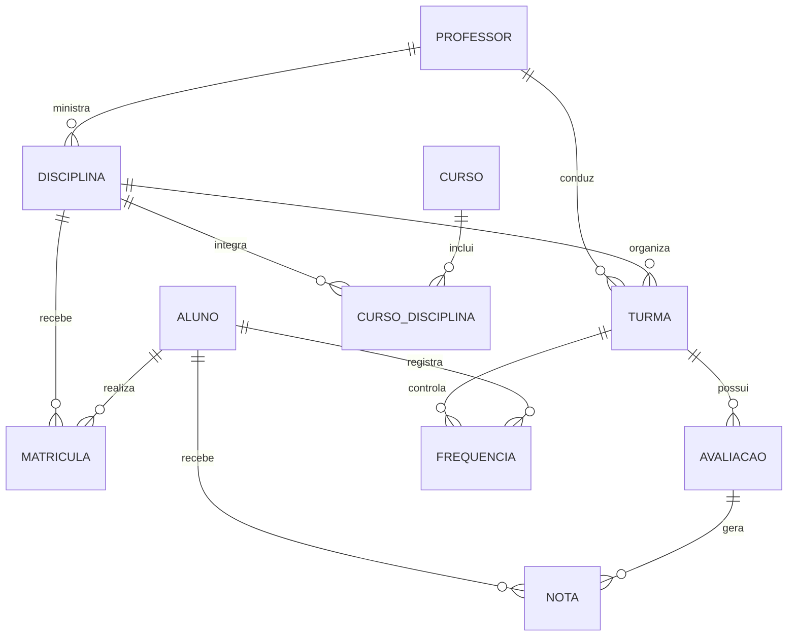

# Desafio Sprint 6 — Banco de Dados

Continuação do projeto **Sistema Acadêmico** da Sprint 5. Esta entrega preserva os scripts PostgreSQL originais e acrescenta rotina de backup/restauração e uma introdução ao MongoDB no mesmo domínio.

## Índice
- [Sprint 5 — PostgreSQL](sprint-5-postgresql/README.md)
- [Sprint 6 — Backup e MongoDB](sprint-6-backup-mongodb/README.md)
- [Relação entre as sprints](RELACAO_SPRINTS.md)

## Domínio e modelo relacional

O sistema acadêmico gerencia alunos, professores, disciplinas, matrículas, cursos, turmas, avaliações, notas e frequência.

## Modelo de documentos MongoDB

- `alunos`: dados do aluno e dados de contato/endereço embutidos quando úteis à leitura conjunta.
- `matriculas`: referência ao aluno e à disciplina por identificadores; dados da matrícula e detalhes de consulta em um documento.
- `eventos_academicos`: registros de histórico/frequência que podem crescer com o tempo, referenciando aluno e turma.

A modelagem segue o padrão de acesso: embedding para dados pequenos consultados junto ao documento principal; referencing para históricos crescentes e dados compartilhados. O PostgreSQL continua sendo a fonte relacional do exercício; o MongoDB é uma demonstração independente com dados fictícios, não uma replicação automática.

## Escolhas MongoDB: embedding x referencing

| Escolha | Motivo e trade-off |
|---|---|
| Embedding de contatos/endereço em `alunos` | Leitura conjunta e tamanho limitado; evita uma consulta adicional, mas atualizações isoladas exigem alterar o documento do aluno. |
| Referências `alunoId` e `turmaId` em `eventos_academicos` | Histórico pode crescer continuamente e ser consultado separadamente; requer `$lookup` ou consultas adicionais. |
| Documento de matrícula com referências | Matrícula conecta aluno e disciplina sem duplicar o histórico inteiro; mantém os dados relacionados consultáveis, mas não impõe FK automaticamente. |

## Backup, restauração e regra 3-2-1

O script `08_backup.sh` usa `pg_dump -Fc`, registra logs e remove arquivos com mais de 30 dias. O agendamento diário às 02h está documentado em `09_cron_agendamento.md`. O roteiro de restauração está em `10_teste_restauracao.md`.

A regra 3-2-1 recomenda **3 cópias**, em **2 tipos de mídia**, com **1 cópia fora do local principal**. Esta entrega implementa backup local e retenção; não implementa automaticamente a cópia off-site. Em produção, enviar o arquivo para bucket S3 compatível, outro servidor ou armazenamento em nuvem, com criptografia, controle de acesso e teste periódico de restauração.

## PostgreSQL x MongoDB neste domínio

| Cenário | Mais adequado | Exemplo |
|---|---|---|
| Integridade referencial e restrições | PostgreSQL | Impedir matrícula para aluno/disciplina inexistente. |
| Transações ACID entre tabelas | PostgreSQL | Registrar aluno e matrícula na mesma transação. |
| Relatórios e JOINs complexos | PostgreSQL | Média de notas por aluno e contagem de matrículas por disciplina. |
| Esquema semiestruturado e variável | MongoDB | Metadados opcionais de contato e eventos acadêmicos. |
| Leitura de agregado em um documento | MongoDB | Buscar aluno com contatos embutidos em uma consulta. |
| Histórico/logs crescentes | MongoDB pode ser útil | Eventos de frequência consultados separadamente; a escolha depende de consistência e requisitos do sistema. |

MongoDB não substitui automaticamente as garantias de integridade do modelo relacional. A escolha depende dos padrões de acesso, consistência, volume e requisitos do domínio.

## Como executar

### Pré-requisitos
- PostgreSQL e cliente `psql`, `pg_dump`, `pg_restore`, `createdb`.
- Bash em Linux/macOS ou ambiente compatível (por exemplo, WSL no Windows).
- MongoDB e `mongosh`.
- Configure autenticação fora do repositório; nunca versione senhas.

### Ordem sugerida
1. Execute a Sprint 5 em um banco de teste, na ordem: `01_ddl.sql`, `02_inserts.sql`, `03_indices.sql`, `04_consultas.sql`, `05_transacoes.sql`, `06_permissoes.sql` (com permissões adequadas) e `07_explain.sql`.
2. Configure as variáveis no início de `08_backup.sh`, dê permissão com `chmod +x` e execute o backup.
3. Siga `09_cron_agendamento.md` para agendar e `10_teste_restauracao.md` para validar a restauração.
4. Execute os scripts MongoDB, em ordem, com `mongosh sprint-6-backup-mongodb/mongodb/11_mongodb_setup.js`, depois `12_mongodb_insercao.js`, `13_mongodb_consultas.js` e `14_mongodb_indices_explain.js`.

As saídas reais de restauração e `explain()` devem ser capturadas pela equipe. Documentos de roteiro não substituem evidências de execução real.

## Estrutura
Veja a pasta [sprint-5-postgresql](sprint-5-postgresql/) para os arquivos originais e [sprint-6-backup-mongodb](sprint-6-backup-mongodb/) para os novos entregáveis.
