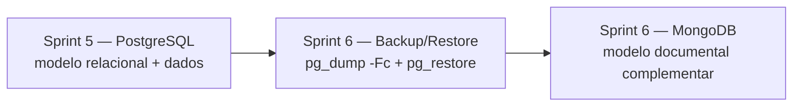

# Relação entre Sprint 5 e Sprint 6

## Fluxo

O backup protege o estado do PostgreSQL no momento da execução. MongoDB é uma demonstração do mesmo domínio com dados fictícios; não há migração/sincronização automática.

## Mapeamento PostgreSQL → MongoDB

| Tabela PostgreSQL | Collection/campo MongoDB | Decisão |
|---|---|---|
| `aluno` | `alunos` | Documento principal; contato/endereço embutidos. |
| `professor` | Sem collection própria | Permanece no PostgreSQL nesta demonstração. |
| `disciplina` | `matriculas.disciplinaId` e `disciplina` | Referência lógica e nome de exibição; sem sincronização. |
| `matricula` | `matriculas` | Documento independente com referências a aluno e disciplina. |
| `curso` | Campo `alunos.curso` | Valor demonstrativo embutido; em produção pode ser referência. |
| `turma` | `eventos_academicos.turmaId` | Referência lógica; collection de turmas não criada. |
| `avaliacao` | Sem equivalente completo | Permanece no PostgreSQL. |
| `nota` | Evento `tipo: "nota"` | Histórico referenciando aluno/turma. |
| `frequencia` | Evento `tipo: "frequencia"` | Histórico crescente separado do perfil. |
| `curso_disciplina` | Sem equivalente completo | Associação N:N permanece no PostgreSQL. |

## Scripts da Sprint 5 que alimentam o banco protegido

| Script | Papel |
|---|---|
| `01_ddl.sql` | Cria tabelas, PKs, FKs e constraints. |
| `02_inserts.sql` | Insere dados de exemplo. |
| `03_indices.sql` | Cria índices adicionais. |
| `04_consultas.sql` | Consultas de leitura. |
| `05_transacoes.sql` | Demonstra operações confirmadas e canceladas. |
| `06_permissoes.sql` | Configura roles, usuários e privilégios. |
| `07_explain.sql` | Analisa planos de execução. |

O backup protege o estado existente, independentemente do script que inseriu/alterou cada registro.

## Reaproveitado e novo
**Sprint 5 reaproveitada:** domínio Sistema Acadêmico, dez tabelas e scripts SQL originais 01–07, copiados sem alteração.

**Sprint 6 adicionada:** backup `08_backup.sh`, cron, roteiro/consulta de restauração, collections MongoDB, consultas, `$lookup`, índices, explain, documentação e arquivos de configuração exemplo.

## Limitações conhecidas
- Confirme o nome real do banco; o backup usa `sistema_academico` como padrão configurável.
- Contagens e planos reais precisam ser medidos no ambiente da equipe.
- Retenção local de 30 dias está prevista, mas envio off-site não é automatizado.
- MongoDB contém dados fictícios e não sincroniza com PostgreSQL.
- Nem todas as tabelas têm collections equivalentes; veja o mapeamento.
- O script de permissões da Sprint 5 exige privilégios adequados e cria usuários sem senha.
