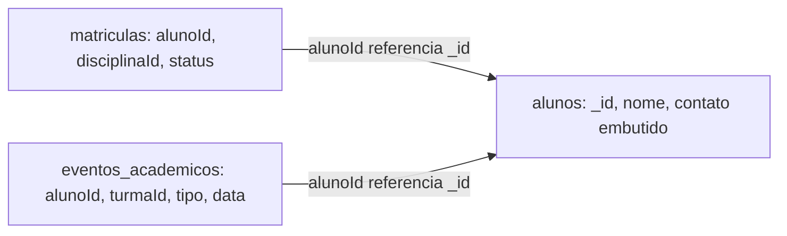

# Modelo documental MongoDB — Sistema Acadêmico

## Collections
- **alunos**: documento principal; contato/endereço embutidos por serem dados pequenos lidos junto ao perfil. Campos opcionais demonstram esquema variável.
- **matriculas**: contém `alunoId` e `disciplinaId` como referências lógicas.
- **eventos_academicos**: eventos de frequência e nota referenciam `alunoId` e `turmaId`. O histórico fica separado por poder crescer continuamente.

## Justificativa e trade-offs
Embedding de contato/endereço reduz leituras adicionais e é adequado a dados pequenos que acompanham o aluno. Referencing é preferível para eventos que crescem continuamente e podem ser consultados por período ou tipo. MongoDB não aplica foreign keys automaticamente; a aplicação deve manter a integridade das referências.

Os documentos são fictícios e demonstrativos, sem importação automática do PostgreSQL.
